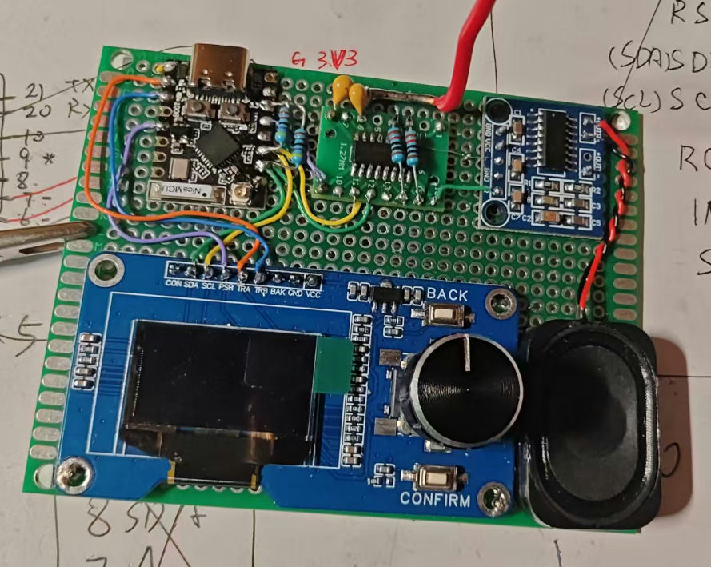

# Si4732 收音机（ESP32-C3 · ESP-IDF）

基于 **ESP-IDF 6.1 / ESP32-C3** 的 Si4732-A10 收音机工程骨架。
工程结构从 ESP32-C3 传感器采集模板复制而来，已裁掉 IMU / 温湿度 / 气压计 /
WiFi 网页 / CSV 日志等模块，替换为 Si4732 收音链路。

> 当前阶段：**骨架 + 基础收音 + SSB（USB/LSB）**。
> Si4732 驱动（复位、上电、REFCLK、调谐、搜台、音量、状态读取、SSB 补丁）
> 已实现；应用层（OLED 页面、编码器交互、串口命令）是可用但精简的骨架，
> 后续按“待办路线”继续补功能。

## 硬件平台

- **芯片**：ESP32-C3（RISC-V 单核，4MB Flash）
- **开发板**：ESP32-C3 Super Mini（原生 USB，下载走 GPIO18/19）
- **收音芯片**：Si4732-A10（FM / AM / SW / LW，7 位 I2C 地址 0x11，写地址 0x22）
- **显示**：0.96 寸 OLED（SSD1306/SSD1315，128×64，I2C 0x3C）
- **输入**：EC11 旋转编码器（A/B 相 + 按键）
- **音频**：Si4732 LOUT/ROUT → PAM8403 → 4Ω 3W 扬声器

### 硬件实物



> 洞洞板原型：ESP32-C3 Super Mini、AMS1117-3.3 稳压模块、Si4732-A10 模块、
> 显示模块、EC11 编码器、PAM8403 功放与扬声器。
> 具体接线以“引脚分配”和“当前实测电路状态”为准。

### 引脚分配

| 编号 | ESP32-C3 | 连接 | 说明 |
|---|---|---|---|
| 1 | GPIO1 | Si4732 SDIO + OLED SDA | I2C 数据线，**外部 10 kΩ 上拉到 3V3** |
| 2 | GPIO2 | Si4732 SCLK + OLED SCL | I2C 时钟线，**外部 4.7–10 kΩ 上拉到 3V3** |
| 3 | GPIO3 | Si4732 GPO1（4 脚） | 复位时由固件推挽拉高，保证 GPO1=1；运行时轮询，不用中断 |
| 4 | GPIO4 | Si4732 RST | 复位，高电平正常工作 |
| 5 | GPIO5 | Si4732 RCLK | LEDC 输出 32.768 kHz |
| 6 | GPIO6 | EC11 A | 内部上拉 |
| 7 | GPIO7 | EC11 B | 内部上拉 |
| 8 | GPIO8 | 板载 LED | 状态指示 |
| 9 | GPIO9 | EC11 按键 | BOOT 脚，内部上拉，上电瞬间不要按住 |

> Si4732 的 **INT（INTB / GPO2/INT，3 脚）不接 ESP32，而是用外部 10 kΩ 电阻下拉到 GND**。
> 详见下方“当前实测电路状态”。

I2C 速率默认 **400 kHz**（`components/BSP/board/board.h` 中 `BOARD_I2C_CLK_HZ`）。
长导线或没有外部上拉时改到 100 kHz。

### 不能省的硬件

- SDA/SCL 各一个**外部 4.7–10 kΩ 上拉电阻**到 3V3（内部上拉太弱；当前实测 SDA 用 10 kΩ）
- Si4732 **INT（INTB / GPO2/INT，3 脚）外部 10 kΩ 下拉电阻到 GND**
  （否则可能被采样成 SPI，I2C 不稳定）
- FMI 串联 1 nF C0G 耦合电容
- RST 不能悬空
- SENB 接地（7 位地址 0x11）
- VDD 只能接 3.3 V，且必须稳定（两节 1.5 V 干电池带不动）

> **这里的上拉/下拉都是外接电阻**，不是启用 MCU 或芯片的内部上拉/下拉。
> 芯片内部只有 1 MΩ 弱上/下拉，仅用于 RST 期间的默认电平，不能代替 I2C 上拉和 INT 下拉。

### 当前实测电路状态

| 引脚 | 接法 | 作用 |
|---|---|---|
| **INT（INTB / GPO2/INT，3 脚）** | **外部 10 kΩ 电阻下拉到 GND** | RST 上升沿采样为 0，选中 2-wire；悬空或受干扰时可能进 SPI，I2C 时好时坏 |
| **GPIO1 / SDA** | **外部 10 kΩ 电阻上拉到 VDD（3.3 V）** | 外部上拉必须可靠，仅靠内部上拉会偶发 NACK |
| GPO1（4 脚） | GPIO3 复位时推挽拉高，之后释放为输入上拉 | 保证 GPO1=1，配合 INT=0 选中 2-wire |
| SENB | GND | 7 位 I2C 地址 0x11 |

**实测结论：**

- 上面这套接法下，芯片可以被**正常识别（0x11）并稳定工作**：调谐、FM/AM/SW、SSB 补丁都正常；
- **其他状态不稳定**，常见现象：
  - 芯片时有时无、I2C NACK、开机偶发识别失败；
  - INT 悬空或被上拉时，可能被采样成 **SPI 模式**，完全不响应 I2C；
  - GPO1 被下拉到 GND 时，会进 **3-wire 模式**，同样不响应 I2C；
  - SDA/SCL 只有内部上拉时，400 kHz 下波形上升沿太慢，容易误码。

### 供电

- **两节 1.5 V 干电池带不动**：标称 3.0 V，带载后会跌到 2.7 V 以下，
  ESP32-C3 + OLED + Si4732 一起工作时会复位、掉 I2C、屏幕闪烁；
- 需要稳定 **3.3 V**：
  - USB / 充电宝 + LDO（AMS1117-3.3、ME6211 等）；
  - 或 3.7 V 锂电池 + LDO；
  - VDD 附近加 **10 µF + 100 nF** 去耦，Si4732 的 VDD 单独走线更稳。

## 目录结构

```
Si4732-A10/
├─ CMakeLists.txt              # project(Si4732_Radio)
├─ sdkconfig.defaults          # 目标芯片/Flash/分区/控制台/u8g2
├─ partitions-4MiB.csv         # 4MB Flash：应用分区 3MB
├─ main/
│  ├─ main.c                   # app_main + radio/ui/console/led 任务 + UI
│  └─ settings.c/h             # NVS 设置持久化（波段/频率/音量/静音）
├─ components/
│  ├─ BSP/                     # 板级支持
│  │  ├─ board/board.h         # 引脚映射（唯一改引脚的地方）
│  │  ├─ led/                  # LED
│  │  ├─ rclk/                 # LEDC 32.768 kHz 参考时钟
│  │  └─ encoder/              # EC11 正交解码 + 按键长短按
│  ├─ devices/                 # 外设驱动
│  │  ├─ i2c/                  # 共用 I2C 总线 + 互斥锁 + 扫描
│  │  └─ oled/                 # 128×64 OLED（u8g2）
│  ├─ radio/
│  │  └─ si4732/               # Si4732 驱动（AN332 命令层 + SSB 补丁）
├─ docs/
│  └─ hardware.jpg             # 硬件实物照片（README 引用）
├─ tools/gen_cpp_properties.ps1
└─ .vscode/                    # IntelliSense 配置
```

## 软件架构

| 任务 | 优先级 | 职责 |
|---|---|---|
| `radio` | 6 | Si4732 初始化/重试、编码器状态机（主页/菜单/音量/BFO）、调谐、1s 状态轮询（RSSI/SNR 每秒刷新）、设置延时保存 |
| `encoder`（BSP 内部） | 5 | 2ms 扫描 A/B 相与按键，2ms 内消抖、长短按判定 |
| `ui` | 3 | 主页/设置菜单/音量/BFO 页面渲染（OLED 失败 2 秒重试） |
| `console` | 2 | UART0 读取调试命令 |
| `led` | 1 | 每 5 秒亮 0.5 秒 |

关键约束：

- **I2C 互斥**：Si4732 与 OLED 共用总线，驱动内部统一用 `board_i2c_lock()`
- **阻塞操作在任务里**：调谐/搜台最长等待 2 秒，但只阻塞 `radio` 任务
- **参考时钟先行**：`rclk_start()` → `board_i2c_init()` → `si4732_init()`
- **时钟模式固定**：本板无晶振，由 GPIO5 输出 32.768 kHz（XOSCEN=0）；若换成自带晶振的模块，把 `SI4732_BOARD_HAS_CRYSTAL` 改成 1
- **不启用 WiFi/BLE**：避免射频噪声串入接收链路

## 编译与烧录

```powershell
idf.py set-target esp32c3     # 首次
idf.py build
idf.py -p COM21 flash monitor # Ctrl+] 退出
```

首次构建会自动从组件仓库下载 `esp-idf-lib/i2cdev` 与 `nixy4/u8g2`。

分区表（`partitions-4MiB.csv`）：

| 分区 | 类型 | 偏移 | 大小 |
|---|---|---|---|
| nvs | data/nvs | 0x9000 | 24KB |
| phy_init | data/phy | 0xf000 | 4KB |
| factory | app | 0x10000 | 3MB |

### 串口命令（UART0，115200）

| 命令 | 功能 |
|---|---|
| `f101100` | FM 101.100 MHz（也可写 `f101`） |
| `a1000` | 中波 1000 kHz |
| `s9700` | 短波 9700 kHz |
| `l200` | 长波 200 kHz |
| `fm` / `am` / `sw` / `lw` | 切换波段 |
| `usb` / `lsb` | 进入 SSB 上边带 / 下边带（FM 时自动先切 SW） |
| `ssb0` | 退出 SSB，回到普通 AM |
| `bfo150` / `bfo-150` | 设置 BFO 偏移（Hz，范围 ±16383） |
| `bw0` ~ `bw5` | SSB 音频带宽：1.2k / 2.2k / 3k / 4k / 500Hz / 1kHz |
| `i2c` / `diag` | 扫描 I2C 总线并打印 Si4732/OLED 在线状态与时钟模式 |
| `v` | 打印频率 / RSSI / SNR / 音量 / 静音 |
| `vol40` | 音量 0~63 |
| `mute` / `mute0` / `mute1` | 切换静音 / 取消静音 / 静音 |
| `save` | 立即把当前设置写入 NVS |
| `+` / `-` | 向上 / 向下搜台（SSB 下不支持） |
| `h` | 帮助 |

> 控制台主输出是 UART0（GPIO20/21），USB Serial/JTAG 作为副控制台。
> 用 USB 线看日志没问题，但**串口输入只从 UART0 读取**。

### 编码器操作（分区主页）

屏幕分三个区域，字体加大（频率 10×20，状态/列表 6×10）：

```
┌────────────────────────────┐
│       14.270000MHz         │  ← 上区：大字频率
│ SW USB P:OK R49 S0    ▮ ▮  │  ← 中区：波段/模式/补丁 + RSSI/SNR 数字和电平条
├────────────────────────────┤
│ BAND SW      VOL  30       │  ← 下区：3 行 × 2 列
│ BW   2.2k    SSB  USB      │     六个字段同时显示
│ BFO +0       MUTE OFF      │
└────────────────────────────┘
```

- 选中项规则：**未进入编辑时**，频率整条反色、下区字段反色第一个字符；**进入编辑后**，频率只反色当前调节的位、字段整个半屏反色
- R/S 电平条：屏幕最右侧两条 **2px 宽竖条**，从最下（y=63）一直画到最上（y=0）；RSSI 满格 **48**、SNR 满格 **12**（即 R24 / S6 正好半屏 32px），每秒刷新一次；频率显示区右侧预留 8px 给这两条
- **未编辑**：旋转移动选中项（`FREQ` / `BAND` / `BW` / `BFO` / `VOL` / `SSB` / `MUTE`），短按进入编辑
- **未编辑双击**：向上自动搜台；**未编辑长按**：向下自动搜台（SSB 下不支持，直接忽略）
- **编辑中**：旋转修改当前项，短按退出编辑
- **编辑中长按**：退出编辑并回到 `FREQ`
- **自动搜台门限**：FM RSSI 5 dBµV；AM/SW/LW RSSI 不限、SNR 10 dB（参考 PU2CLR 示例 / 触摸屏工程）
- **频率编辑**：
  - 默认步进：**FM 0.1 MHz（100k）**、**SW 0.01 MHz（10k）**；切波段/进 SSB 时自动套用
  - 双击循环步进：
    - FM：`10M → 1M → 100k → 10k`
    - AM / LW：`100k → 10k → 1k`
    - SW（普通 AM）：`10M → 1M → 100k → 10k → 1k`
    - SW + SSB：`10M → 1M → 100k → 10k → 1k → 100 → 10 → 1 Hz`
  - 大字频率中当前要调的位会反白
  - SW 的 1 kHz 以下通过 BFO 实现，BFO 也可以单独调
- `BAND`：旋转切换 FM / AM / SW / LW
- `BW`：旋转切换 `1.2k / 2.2k / 3k / 4k / 500 / 1k`
- `SSB`：旋转切换 OFF / USB / LSB（FM 下自动切 SW；首次进入下载补丁约 3 秒）
- `MUTE`：旋转 ON / OFF
- `BFO`：旋转 ±10 Hz

频率显示格式：

| 波段 | 显示 |
|---|---|
| FM | `101.100MHz` |
| SW | `14.270000MHz`（MHz，6 位小数） |
| AM / LW | `1000kHz` / `200kHz` |

> 短按会延迟约 350 ms 再上报，用来区分单击和双击；双击只循环步进，不会触发进入/退出编辑。
> UI 在状态变化时立即重绘，无变化时每秒兜底重绘一次；整屏 1024 字节，400 kHz 下一帧约 23 ms。

## 设置持久化（NVS）

- 命名空间：`radio`
- 保存项：**当前波段、频率、带宽、音量、静音**
- 触发：任何修改后 **延时 2 秒** 自动写入，连续拧编码器只写一次
- 上电：恢复波段/频率/带宽/音量/静音；**SSB 始终默认关闭**（补丁在 RAM，不保留，需要重新进入）
- `BOOT_ALWAYS_FM` 默认为 0；改成 1 可让开机固定 FM 101.100MHz
- 想立即保存可在串口发 `save`
- 擦除设置：`idf.py erase-flash`，或串口发默认值后再触发保存

## SSB（USB/LSB）

Si4732-A10 与 Si4735-D60 同 die，支持通过补丁开启 SSB：

1. 首次进入 SSB 时，`si4732_ssb_enable()` 会：
   - 先 `POWER_UP(FUNC=15)` 查询 library ID
   - 以 **PATCH=1** 重新 POWER_UP
   - 把 `components/radio/si4732/ssb_patch_full.h`（完整补丁，约 15.8 KB，
     补丁 ID **0x9D29**，来源 Pocket-FT8 / SI4735 Touchscreen 工程）
     按 8 字节一行、每行等待 CTS 下载到芯片内部 RAM
   - 写 `SSB_MODE`（带宽/边带滤波/AVC/AFC）和 `SSB_BFO`
   - 补丁最后一行 CTS 置高即完成 boot（AN332 7.2.2，不再重复 POWER_UP），
     随后重新写 REFCLK/音量，并以 `AM_TUNE_FREQ` 的 ARG1 **D7:D6 边带位**调谐
     （`10`=USB，`01`=LSB；与 PU2CLR 库一致）
2. 补丁保存在芯片 RAM，**掉电或复位后丢失**；切换 FM/AM 不需要重新下载
3. 完整补丁约 2000 行，400 kHz 下下载约 2~4 秒；期间 UI 暂停刷新、跳过总线扫描

> **注意**：补丁内容来自 PU2CLR 库收录的 Vadim Afonkin 版本，仅建议个人实验使用，
> 不要用于商业产品。本板无晶振，SSB 补丁也使用外部 RCLK（XOSCEN=0）。

SSB 只影响 AM 模式（MW/SW/LW），FM 下调用会返回错误；SSB 模式没有硬件搜台，
`si4732_seek()` 会返回 `ESP_ERR_NOT_SUPPORTED`。

## Si4732 驱动 API（`components/radio/si4732/si4732.h`）

```c
si4732_init();                 // 复位 + 上电 FM + REFCLK + 音量
si4732_set_band(SI4732_BAND_SW);
si4732_tune(9700);             // kHz
si4732_seek(true);             // 向上搜台
si4732_set_volume(40);         // 0~63
si4732_get_status(&status);    // 频率 / RSSI / SNR / SSB / valid
si4732_set_property(prop, v);  // AN332 通用属性

si4732_ssb_enable(true);        // 下载补丁并进入 USB（仅首次下载）
si4732_ssb_set_bfo(-150);       // BFO 偏移 Hz
si4732_ssb_set_bandwidth(SI4732_SSB_BW_2K2);
si4732_ssb_disable();           // 回到普通 AM
```

实现要点：

1. 每条命令前/后都轮询 STATUS 的 CTS 位（bit7），ERR 位（bit6）置位时报错
2. `POWER_UP` 参数：FM 用 `FUNC=0`，AM/SW/LW 用 `FUNC=1`，OPMODE=0x05（模拟输出），XOSCEN=0（外部 RCLK）
3. 上电后设置 `REFCLK_FREQ=32768`、`REFCLK_PRESCALE=1`，否则频率整体偏移
4. FM 与 AM 模式切换需要重新 `POWER_UP`；MW/SW/LW 之间只改频率
5. TUNE_STATUS 的 READFREQ：FM 单位 10 kHz，AM 单位 kHz；**调谐完成看 STATUS 的 STC 位，不看 VALID**
   （VALID 只表示信号达到搜台门限，没接天线时调谐已完成但 VALID=0）
6. `FM_TUNE_FREQ` 必须带 4 个参数（最后一个 `ANTCAP=0` 表示自动）；`AM_TUNE_FREQ` / `AM_SEEK_START` 带满 6 字节，ANTCAPL 在短波（>1800 kHz）时置 1
7. 每次切换波段都会写入 seek 上下限与步进（FM 属性单位 10 kHz），避免 SW/LW 搜台跑回中波范围
8. 音量与静音分离：`si4732_set_volume()` 只写 RX_VOLUME，静音用 `si4732_set_mute()`
9. SSB 补丁：PATCH 模式上电 → 8 字节/行、每行等 CTS 下载 → 写 `SSB_MODE`/`SSB_BFO`
   → 正常 AM 模式重新上电 → `AM_TUNE_FREQ` 的 **ARG1 D7:D6** 选择边带（01=LSB，10=USB）
10. `SSB_BFO` 是有符号 Hz，写成 16 位补码；`SSB_MODE` **高字节**是
    `AVC_DIVIDER / AVCEN / SMUTESEL / DSP_AFCDIS`，**低字节**是 `AUDIOBW[3:0] | SBCUTFLT[7:4]`
11. **总线模式在 RST 上升沿由 GPO1/GPO2 采样决定**（AN332 第 6 节）：
    2-wire 要求 GPO1=1、GPO2=0。驱动在复位前把 GPO1（GPIO3）推挽拉高，
    RST 上升 50 µs 后再释放为输入上拉，避免落进 3-wire 模式导致 I2C 完全不应答

## 参考资料

| 资料 | 位置 | 用途 |
|---|---|---|
| PU2CLR SI4735 Arduino 库 | `D:\Desktop\SI4735` | 命令参数、波段配置、RDS / SSB 实现参考 |
| AN332 官方示例代码 | `AN332_Si47xxExampleCode/` | 复位时序、CTS 轮询、FM/AM 命令格式 |
| AN332 编程手册 | `AN332.pdf` | 完整命令与属性定义 |
| Si4732-A10 数据手册 | `Si4732-A10.pdf` | 引脚、电气参数、RCLK 要求 |

## 待办路线（骨架之后）

- [ ] GPO1 下降沿中断 + 信号量替代 TUNE_STATUS 轮询（降低调谐期间的 I2C 占用）
- [ ] OLED 多页面：主界面 / 信号质量 / 版本信息 / 音量条
- [ ] 频率收藏与掉电保存（NVS：频率、波段、音量、静音状态）
- [ ] FM 立体声指示（解析 `FM_RSQ_STATUS` 的 STEREO 位）
- [ ] RDS：`FM_RDS_STATUS` 读取电台名 / 节目类型
- [ ] RSSI/SNR 滑动平均平滑（降低读数跳动）
- [ ] 编码器加速（快速旋转时步进加倍）
- [ ] 电池供电与低功耗

## 调试顺序

1. 上电看日志：`I2C 扫描` 应出现 `0x11`（Si4732）和 `0x3C`（OLED）
2. 若没有 0x11：查 SENB 是否接地、RST 是否被拉低、**SDA 外部 10 kΩ 上拉**、
   **INT（INTB / GPO2/INT，3 脚）外部 10 kΩ 下拉到 GND**，以及供电是否稳定 3.3 V
3. 若频率偏移：确认 GPIO5 有 32.768 kHz 波形、`REFCLK_FREQ` 设置为 32768
4. 串口发 `f101100`，听扬声器是否有声音
5. 切 `am` + `a1000` 测磁棒天线
6. 发 `sw` + `s9700`，再发 `usb`/`lsb`，听 SSB 是否有啸叫/语音
7. 最后再接编码器和 OLED 排查交互

## 常见问题

| 现象 | 原因 / 处理 |
|---|---|
| I2C 扫描不到 0x11 | SENB 未接地、RST 悬空、上拉缺失、模块没供电 |
| 芯片时有时无 / 偶发 NACK | **INT（3 脚）悬空或被上拉** → 外部 10 kΩ 下拉到 GND；**SDA 只有内部上拉** → 外部加 10 kΩ 到 3V3 |
| 加/拔 INT 后 I2C 完全无响应 | INT 被上拉时芯片采样成 **SPI 模式**；INT 被下拉（0）且 GPO1=0 时进 **3-wire**。2-wire 必须 INT=0、GPO1=1 |
| 两节 1.5 V 干电池供电不稳定 | 标称 3.0 V，带载跌破 2.7 V；需要稳定 3.3 V（USB/充电宝 + LDO，或 3.7 V 锂电 + LDO） |
| 频率整体偏移 | RCLK 没输出或 `REFCLK_FREQ` 没设成 32768 |
| 调谐总超时 | 芯片未正常上电（检查 POWER_UP 后的 CTS），或天线/波段不匹配 |
| OLED 花屏 | I2C 速率过高，把 `BOARD_I2C_CLK_HZ` 降到 400k 以下 |
| 上电直接进下载模式 | GPIO9（BOOT/编码器按键）上电瞬间被按住 |
| 串口命令没反应 | 命令走 UART0（GPIO20/21），不是 USB |
| SSB 没声音或啸叫 | 先用 `bfo150`/`bfo-150` 微调；确认在 SW/AM 波段 |
| SSB 切换后频率偏移 | 补丁模式上电后没有重新写 `REFCLK_FREQ`，检查 RCLK 与 `si4732_patch_power_up()` |
| OLED 显示 `Si4732 NOT READY` | 屏幕第二行：`SI47` 是 0x11 是否在线，`RCLK` 是时钟是否启动；第三行 `ERR 阶段 错误码` 指出卡在哪一步；也可发 `diag` |
| 日志 `复位后等待 CTS 失败` | I2C 没有应答：SENB 是否接 GND、模块是否供电、地址是否 0x11（不是 0x22） |
| 日志 `等待 CTS 超时` | RCLK 没有到达芯片：量 GPIO5 应为约 1.6V（32.768kHz 50% 方波），检查到模块 RCLK 的连线 |
